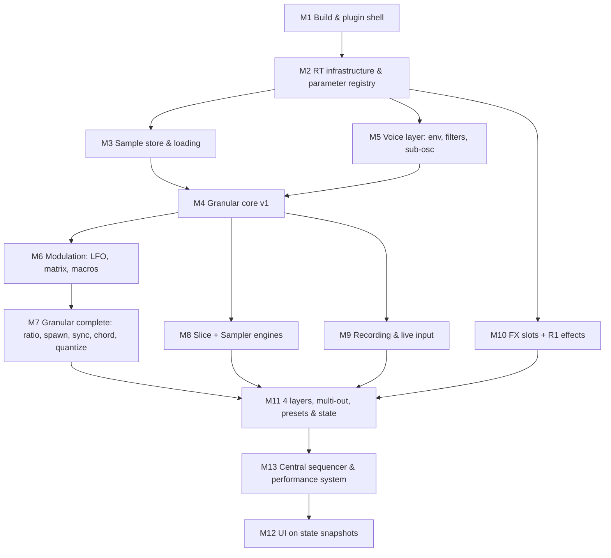

# Development Roadmap

**Status:** Proposal; gated by research and owner approval. No phase is automatically authorized by this roadmap. Do not build all features in parallel or skip real-time validation.
**Version:** 0.2 (Issue #1)

## Change summary (v0.1 → v0.2)

- **Phase numbering aligned with CLAUDE.md** (8 phases). v0.1 had 6 phases: its "Phase 5 — Incremental implementation" is now Phases 5 (plan & acceptance criteria) + 6 (implementation), and "Phase 6 — Validation and release" is now Phases 7 + 8. No v0.1 content was dropped; each phase's v0.1 text is kept under "Scope".
- Added per-phase **dependencies**, **deliverables** and **measurable exit criteria**.
- Added a proposed **implementation milestone plan** (M1–M13) for Phase 6 with dependencies. It is a planning aid only; it authorizes nothing.
- Numeric thresholds marked *(proposed)* are placeholders for owner/ChatGPT approval in Phase 5.

---

## Phase overview and dependencies

| Phase | Depends on | Gate owner |
|---|---|---|
| 1 Reference research | DEC-001, DEC-002 | ChatGPT review → owner |
| 2 Requirements & release scope | Phase 1 exit; owner answers to OPEN_QUESTIONS §0 | Owner |
| 3 Architecture | Phase 2 exit (R1 scope frozen) | ChatGPT → owner |
| 4 UI/UX | Phase 2 exit; Phase 3 parameter model (Q-T12) | Owner |
| 5 Plan & acceptance criteria | Phases 3 and 4 exit | ChatGPT → owner |
| 6 Implementation | Phase 5 exit; explicit owner authorization per milestone | ChatGPT review per PR |
| 7 Testing & optimization | Phase 6 milestones complete for the release scope | ChatGPT → owner |
| 8 Release | Phase 7 exit; Q-P01, Q-P03, Q-L03 answered | Owner |

---

## Phase 1 — Reference research and product definition

**Scope (v0.1):** Study GR-MEGA manual 1.8.d, build traceable feature map, classify evidence and identify open decisions.

**Deliverables:** GR_MEGA_FEATURE_MAP.md, refined GRANULAR_SYNTH_REQUIREMENTS.md, DSP_ARCHITECTURE.md options, OPEN_QUESTIONS.md, this roadmap, PHASE1_REFERENCE_SUMMARY.md (Issue #1).

**Measurable exit criteria**
1. Every feature-map row has an evidence class (MC / INT / PROP / UNV / RN); every MC row cites page and section — 0 exceptions.
2. All manual chapters relevant to the instrument (pp. 11–164) are represented in the feature map; hardware-only chapters are listed as N/A.
3. All detected manual inconsistencies are logged with page references (feature map §15) and mirrored as OPEN_QUESTIONS §C items.
4. ChatGPT review comments on the Issue #1 PR are resolved or explicitly deferred.
5. Owner acknowledges the PR (merge = Phase 1 closed).

---

## Phase 2 — Requirements and release scope

**Scope (v0.1):** Define first-release features, priorities, supported formats, performance targets and acceptance criteria.

**Depends on:** Phase 1 exit and approved product baseline DEC-015…DEC-021; Phase 2 still finalizes remaining R1 tiers, format scope and exclusions.

**Deliverables:** GRANULAR_SYNTH_REQUIREMENTS.md v1.0 (tiers approved), PRODUCT_VISION.md updated with use-case priority, DECISIONS_LOG entries.

**Measurable exit criteria**
1. Every GS-* requirement has an **approved** tier (R1 / L2 / L3 / OPT / rejected) — 0 "proposed" left in R1.
2. DEC-004 (formats) and DEC-006 (first-release engines, layer/voice limits) moved to *Approved* or *Rejected*.
3. Performance targets for R1 stated numerically (reference machine Q-P10, sample-rate/buffer range Q-T17, CPU budget for a named reference patch).
4. Requirements document tagged `requirements-v1.0`.

---

## Phase 3 — DSP / application architecture

**Scope (v0.1):** Compare frameworks; design real-time audio architecture, DSP boundaries, sample management, parameter model and test strategy.

**Depends on:** Phase 2 exit.

**Deliverables:** DSP_ARCHITECTURE.md v1.0; parameter-ID scheme specification; threading/ownership model; memory budget; decision records for Q-T01…Q-T17.

**Measurable exit criteria**
1. DEC-005 (framework) *Approved* or replaced; Q-T01–Q-T17 each *Approved*, *Rejected* or explicitly deferred with a phase.
2. Parameter-ID scheme approved (Q-T12) — recorded as irreversible after first public release.
3. CPU feasibility confirmed: grain-rendering cost per grain-sample measured on the reference machine and the default global grain budget fixed (Q-T07). *This needs a throwaway benchmark spike; it requires explicit owner authorization because it is code.*
4. Every R1 requirement maps to at least one architecture module (traceability table, 100 % coverage).

---

## Phase 4 — UI/UX specification

**Scope (v0.1):** Define workflows and interface; prototype high-risk interactions and visualizations.

**Depends on:** Phase 2 exit; Phase 3 parameter model.

**Deliverables:** UI_UX_SPECIFICATION.md v1.0 (screens, workflows, controller mapping, accessibility); interactive mock-ups of the main view, sample editor, modulation routing, layer view.

**Measurable exit criteria**
1. Every R1 requirement with a user-facing aspect is mapped to a screen/interaction (100 % coverage table).
2. The 8-knob engine section mapping for all R1 engines is specified (GS-UI-002).
3. Owner sign-off on mock-ups for the four core views.

---

## Phase 5 — Implementation plan and acceptance criteria

**Depends on:** Phases 3 and 4 exit.

**Deliverables:** Milestone plan (below) finalized; TESTING_STRATEGY.md v1.0 with reference machine, stress presets, numeric thresholds; per-milestone acceptance criteria; Claude Code assignment drafts (one per milestone, never the whole instrument).

**Measurable exit criteria**
1. Every R1 requirement has at least one acceptance test with a numeric or binary pass condition.
2. Each milestone has: scope, dependencies, acceptance tests, performance measurement, rollback plan.
3. CI plan defined (build, unit tests, auval, pluginval, offline golden renders, RT-safety checks).

---

## Phase 6 — Incremental implementation (proposed milestones)

**Scope (v0.1):** Build a minimal audio/plugin shell; implement and test DSP vertical slices; add sample loading and core granular path; expand according to approved priorities.

Each milestone is a separate, explicitly authorized assignment, on its own branch and PR.

| # | Milestone | Depends on | Key requirements | Measurable acceptance (proposed) |
|---|---|---|---|---|
| M1 | Build system, CI, empty AU/VST3/standalone shell | Q-T01, Q-T03 | GS-PLT-001/002 | CI green; `auval` and pluginval (strictness 10) pass on the empty plugin; Universal 2 binaries |
| M2 | RT infrastructure (SPSC queues, garbage queue, allocation detector), parameter registry, offline renderer | M1, Q-T12 | REQ-AUD-001/002, GS-NFR-001/005/006 | Allocation detector reports 0 events in a 10-min stress render; registry round-trip tests pass |
| M3 | Sample store: off-thread decode, peak pyramid, atomic swap | M2 | GS-SMG-001/003/004 | 6-min stereo WAV loads without audio-thread stalls (max callback time unchanged ± 5 %); no clicks on swap |
| M4 | Granular core v1: scheduler (Free mode), windows, interpolation, spray/pan/direction/scan/pitch, grain pool, stealing, normalization | M3, M5 | GS-GRN-001…013, 017–020 | Spawn-time error 0 samples at integer and fractional rates; discontinuity detector clean on golden set; CPU per grain-sample measured and recorded |
| M5 | Voice layer: allocation, stealing, envelopes, LPF/HPF slopes, sub-osc, glide, MPE | M2 | GS-VOI-*, GS-MID-002 | Envelope timing error < 1 sample; SVF magnitude response within 0.1 dB of analytic; click-free voice steal |
| M6 | Modulation: 4 LFOs, matrix (50 rows), macros, randoms, follower | M4/M5 | GS-MOD-001…009 | Every registered modulatable parameter reachable from the matrix (automated check); no zipper noise in sweep tests |
| M7 | Granular completion: ratio modes, spawn modes, clock sync, chord/arp, quantization | M6 | GS-GRN-011/014–016, GS-CHD-* | Ratio-mode invariants (density constant where specified) unit-tested; synced spawns sample-accurate vs transport |
| M8 | Sampler engine | M4/M5 | GS-SMP-* (R1) | Loop one-shot/wrap/bounce edge cases tested; sample-rate and loop-boundary tests pass |
| M9 | Recording & live-input granulation, scrolling record | M3, M4, Q-P06 | GS-SMG-008…012 | 1-h loop-record soak with granulation: 0 dropouts, 0 allocations |
| M10 | FX slot host + R1 effects | M2, Q-P11 | GS-FX-001/002/004/006 | Each effect passes impulse/sine tests; FX swap click-free |
| M11 | 4 layers, multi-out buses, presets/templates/library, plugin state | M7–M10, Q-P07/Q-P08 | GS-ARC-001/006, GS-PRS-* | State round-trip bit-exact; preset migration test; standalone vs plugin bit-identical render (GS-PLT-004) |
| M13 | Central step sequencer, pattern library/chains, Performance Sets, live editing and controller mapping | M2, M7, M11 | GS-SEQ-001…012, DEC-019/021 | Variable-length patterns, 8 simultaneous events/step, four-layer event routing, bar-quantized pattern changes, sync sources and controller-only editing pass deterministic timing tests |
| M12 | UI implementation | M2 (snapshots), Phase 4 spec, M13 | GS-UI-* | UI never blocks audio (callback timing unchanged with UI open); all R1 controls present |

**Phase 6 exit:** all R1 milestones accepted and merged after review.

---

## Phase 7 — Testing, profiling and optimization

**Scope (v0.1, part):** Run automated tests, audio stress tests, host compatibility tests, profiling, long-duration stability tests.

**Measurable exit criteria (proposed thresholds, approve in Phase 5)**
1. Reference stress patch at 48 kHz / 128 frames on the reference machine: CPU below the approved budget; 0 dropouts in a 60-min run.
2. 24-h soak (random preset changes, MIDI, recording): 0 crashes, 0 allocations on RT threads, memory growth < 1 %.
3. Host matrix (Q-P09) pass: scan, instantiate, automate, save/reopen session, offline bounce identical to realtime.
4. All golden renders within tolerance; all unit tests green in CI.

---

## Phase 8 — Packaging and release

**Scope (v0.1, part):** Signing/notarization and packaging.

**Depends on:** Q-P01 (name), Q-P03 (distribution), Q-L03/Q-L04/Q-L05 (legal/licences).

**Measurable exit criteria**
1. Notarized, hardened-runtime installer verified on a clean machine for each supported macOS version.
2. Third-party licence notices complete (0 unlicensed dependencies).
3. User documentation covers every R1 feature.
4. Owner release approval recorded in DECISIONS_LOG.md.
