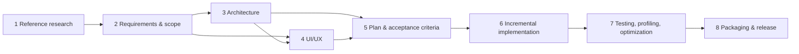
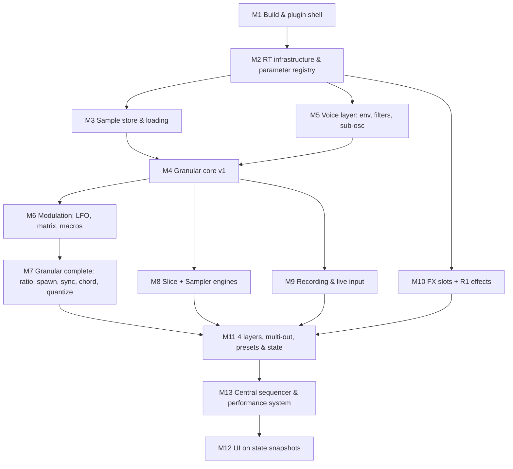

# Development Roadmap

**Status:** Proposal; gated by research and owner approval. No phase is automatically authorized by this roadmap. Do not build all features in parallel or skip real-time validation.
**Version:** 0.5 (Phase 3 API and signal-flow proposal, 2026-11-27)

## Change summary (v0.2 → v0.3)

- Expanded Phase 3 deliverables to include parameter identity, RT threading/ownership, sample/state lifecycle, plugin component/bus, Freeze behavior and 100% R1 architecture traceability specifications.
- Added the Phase 3 architecture completion audit and platform/plugin evidence note as supporting review documents.
- Clarified that proposed architecture documents and host research do not approve a framework, component topology, numeric resource budgets or implementation.\n- Added the R1 cross-module interface contract specification (IF-01…IF-12), the candidate API/service boundaries, and the signal-flow/recording-tap proposal.

## Change summary (v0.1 → v0.2)

- **Phase numbering aligned with CLAUDE.md** (8 phases). v0.1 had 6 phases: its "Phase 5 — Incremental implementation" is now Phases 5 (plan & acceptance criteria) + 6 (implementation), and "Phase 6 — Validation and release" is now Phases 7 + 8. No v0.1 content was dropped; each phase's v0.1 text is kept under "Scope".
- Added per-phase **dependencies**, **deliverables** and **measurable exit criteria**.
- Added a proposed **implementation milestone plan** (M1–M13) for Phase 6 with dependencies. It is a planning aid only; it authorizes nothing.
- Numeric thresholds marked *(proposed)* are placeholders for owner/ChatGPT approval in Phase 5.

---

## Phase overview and dependencies

| Phase | Depends on | Gate owner |
|---|---|---|
| 1 Reference research | DEC-001, DEC-002 | ChatGPT review → owner |
| 2 Requirements & release scope | Phase 1 exit; owner answers to OPEN_QUESTIONS §0 | Owner |
| 3 Architecture | Phase 2 exit (R1 scope frozen) | ChatGPT → owner |
| 4 UI/UX | Phase 2 exit; Phase 3 parameter model (Q-T12) | Owner |
| 5 Plan & acceptance criteria | Phases 3 and 4 exit | ChatGPT → owner |
| 6 Implementation | Phase 5 exit; explicit owner authorization per milestone | ChatGPT review per PR |
| 7 Testing & optimization | Phase 6 milestones complete for the release scope | ChatGPT → owner |
| 8 Release | Phase 7 exit; Q-P01, Q-P03, Q-L03 answered | Owner |

---

## Phase 1 — Reference research and product definition

**Scope (v0.1):** Study GR-MEGA manual 1.8.d, build traceable feature map, classify evidence and identify open decisions.

**Deliverables:** GR_MEGA_FEATURE_MAP.md, refined GRANULAR_SYNTH_REQUIREMENTS.md, DSP_ARCHITECTURE.md options, OPEN_QUESTIONS.md, this roadmap, PHASE1_REFERENCE_SUMMARY.md (Issue #1).

**Measurable exit criteria**
1. Every feature-map row has one of the four canonical evidence classes (Manual-confirmed / Interpretation / Proposal / Unverified); [RN] is only a supplemental source marker, never a standalone class. Every Manual-confirmed row cites page and section — 0 exceptions.
2. All manual chapters relevant to the instrument (pp. 11–164) are represented in the feature map; hardware-only chapters are listed as N/A.
3. All detected manual inconsistencies are logged with page references (feature map §15) and mirrored as OPEN_QUESTIONS §C items.
4. ChatGPT review comments on the Issue #1 PR are resolved or explicitly deferred.
5. Owner acknowledges the PR (merge = Phase 1 closed).

---

## Phase 2 — Requirements and release scope

**Scope (v1.0):** Freeze the R1 product requirements and release tiers; complete functional specifications for Modulation, Effects, Sampler, Presets/Library, MIDI and Audio/I/O; distinguish product decisions from later technical gates; and draft testable product-level acceptance criteria.

**Depends on:** Phase 1 exit and approved product baseline DEC-015…DEC-021; remaining product decisions are resolved under the owner's explicit delegation and recorded in DEC-022…DEC-041.

**Deliverables:**
- `GRANULAR_SYNTH_REQUIREMENTS.md` v1.0 with all 168 GS requirement rows assigned approved tiers.
- `R1_PRODUCT_SPECIFICATION.md` with consolidated product decisions.
- Domain specifications: `MODULATION_SPECIFICATION.md`, `EFFECTS_SPECIFICATION.md`, `SAMPLER_SPECIFICATION.md`, `PRESET_LIBRARY_SPECIFICATION.md`, `MIDI_SPECIFICATION.md`, `AUDIO_IO_SPECIFICATION.md`.
- `R1_RELEASE_SCOPE_MATRIX.md` and `R1_ACCEPTANCE_CRITERIA.md`.
- Updated `OPEN_QUESTIONS.md` and `DECISIONS_LOG.md`.

**Measurable exit criteria**
1. Every GS-* requirement has exactly one approved tier (R1 / L2 / L3 / OPT); no pending/Other tier remains.
2. Product decisions needed to freeze R1 scope are answered or explicitly deferred outside Phase 2. DEC-004 (AU/VST3 target) and DEC-006 (R1 engine/layer scope) are approved.
3. Six domain specifications cover R1 behavior, edge cases, dependencies and unresolved technical details without contradicting DEC-015…DEC-041.
4. R1 scope matrix reconciles to the 168-row inventory: 124 R1, 27 L2, 9 L3, 8 OPT, 0 Other.
5. Every R1 requirement in the six completed domains has at least one observable product-level acceptance criterion; architecture-dependent and numeric performance tests are explicitly carried to Phase 3/5.
6. Requirements document is versioned 1.0. Create the repository tag `requirements-v1.0` only after the owner approves and merges the Phase 2 PR.

**Explicitly deferred:** reference machine and host matrix (Q-P09/Q-P10), sample-rate/buffer feasibility (Q-T17), CPU/RAM/latency budgets (Q-T07 and related), framework/parameter/host-bus architecture (Q-T01…Q-T16), Freeze semantics and implementation; optional physical benchmark A/B work if a GR-MEGA unit becomes available (Q-P13). These are not Phase 2 blockers.
  
---

## Phase 3 — DSP / application architecture

**Scope (v0.1):** Compare frameworks; design real-time audio architecture, DSP boundaries, sample management, parameter model and test strategy.

**Depends on:** Phase 2 exit.

**Deliverables:**
- `PHASE3_ARCHITECTURE_COMPLETION_AUDIT.md` — baseline review, stale-decision reconciliation, gaps and work sequence.
- `PHASE3_PLATFORM_AND_PLUGIN_RESEARCH.md` — current framework, licence, AU and VST3 evidence.
- `DSP_ARCHITECTURE.md` v1.0 — approved module boundaries, signal flow, real-time model, host integration and resource policy.
- `PARAMETER_ID_SPECIFICATION.md` v1.0 — stable IDs, host mapping, parameter metadata, automation and migration.
- `THREADING_AND_OWNERSHIP_SPECIFICATION.md` v1.0 — threads, queues, capacities, ownership, retirement and overload behavior.
- `SAMPLE_AND_STATE_LIFECYCLE_SPECIFICATION.md` v1.0 — loading, recording, sample assets, embedded buffers and state recovery.
- `PLUGIN_COMPONENT_AND_BUS_SPECIFICATION.md` v1.0 — Standalone/AU/VST3 components, buses, MIDI and host capability matrix.
- `FREEZE_BEHAVIOR_SPECIFICATION.md` — approved Freeze behavior and state machine.
- `PHASE3_ARCHITECTURE_TRACEABILITY.md` — every R1 requirement mapped to architecture modules/interfaces and validation obligations.\n- `PHASE3_INTERFACE_CONTRACTS.md` — cross-module contracts for host process, parameters, structural commands, snapshots, samples, recording, Freeze, transport, MIDI, audio routing, plugin state and deterministic rendering.\n- `PHASE3_API_AND_SIGNAL_FLOW_SPECIFICATION.md` — proposed framework-independent service boundaries, illustrative API/data contracts, render-block ordering, signal-flow graph, recording tap options and open routing decisions.
- Updated `OPEN_QUESTIONS.md` and `DECISIONS_LOG.md` with final status of Q-T01…Q-T17 and related architecture decisions.

**Measurable exit criteria**
1. DEC-005 (framework) *Approved* or replaced; Q-T01–Q-T17 each *Approved*, *Rejected* or explicitly deferred with a phase.
2. Parameter-ID scheme approved (Q-T12) — recorded as irreversible after first public release.
3. CPU feasibility confirmed: grain-rendering cost per grain-sample measured on the reference machine and the default global grain budget fixed (Q-T07). *This needs a throwaway benchmark spike; it requires explicit owner authorization because it is code.*
4. Every R1 requirement maps to at least one architecture module and interface (traceability table, 100% coverage of the 124 approved R1 rows); the cross-domain interfaces have documented ownership, timing, boundedness, failure and validation obligations (IF-01…IF-12).\n5. Every R1 row has class/API-level traceability, or the missing detail is explicitly deferred with a target phase and rationale. Domain-level grouping alone is not sufficient for an implementation-readiness claim.\n6. The API and signal-flow proposal is reconciled into one normative graph: voice/layer processing order, live-input/dry routing, per-layer/master recording taps, mute/solo behavior and output bus taps are either approved or explicitly deferred with an owner and rationale.
6. Sample/state lifecycle implements the DEC-025 policy without changing it; Freeze semantics are explicitly approved and testable.
7. Host component/bus decisions are supported by documented host/format evidence or explicitly deferred with an approved limitation.
8. No stale Phase 2 product policy remains in the architecture documents; all proposed values are distinguished from measured results and approved decisions.

---

## Phase 4 — UI/UX specification

**Scope (v0.1):** Define workflows and interface; prototype high-risk interactions and visualizations.

**Depends on:** Phase 2 exit; Phase 3 parameter model.

**Deliverables:** UI_UX_SPECIFICATION.md v1.0 (screens, workflows, controller mapping, accessibility); interactive mock-ups of the main view, sample editor, modulation routing, layer view.

**Measurable exit criteria**
1. Every R1 requirement with a user-facing aspect is mapped to a screen/interaction (100 % coverage table).
2. The 8-knob engine section mapping for all R1 engines is specified (GS-UI-002).
3. Owner sign-off on mock-ups for the four core views.

---

## Phase 5 — Implementation plan and acceptance criteria

**Depends on:** Phases 3 and 4 exit.

**Deliverables:** Milestone plan (below) finalized; TESTING_STRATEGY.md v1.0 with reference machine, stress presets, numeric thresholds; per-milestone acceptance criteria; Claude Code assignment drafts (one per milestone, never the whole instrument).

**Measurable exit criteria**
1. Every R1 requirement has at least one acceptance test with a numeric or binary pass condition.
2. Each milestone has: scope, dependencies, acceptance tests, performance measurement, rollback plan.
3. CI plan defined (build, unit tests, auval, pluginval, offline golden renders, RT-safety checks).

---

## Phase 6 — Incremental implementation (proposed milestones)

**Scope (v0.1):** Build a minimal audio/plugin shell; implement and test DSP vertical slices; add sample loading and core granular path; expand according to approved priorities.

Each milestone is a separate, explicitly authorized assignment, on its own branch and PR.

| # | Milestone | Depends on | Key requirements | Measurable acceptance (proposed) |
|---|---|---|---|---|
| M1 | Build system, CI, empty AU/VST3/standalone shell | Q-T01, Q-T03 | GS-PLT-001/002 | CI green; `auval` and pluginval (strictness 10) pass on the empty plugin; Universal 2 binaries |
| M2 | RT infrastructure (SPSC queues, garbage queue, allocation detector), parameter registry, offline renderer | M1, Q-T12 | REQ-AUD-001/002, GS-NFR-001/005/006 | Allocation detector reports 0 events in a 10-min stress render; registry round-trip tests pass |
| M3 | Sample store: off-thread decode, peak pyramid, atomic swap | M2 | GS-SMG-001/003/004 | 6-min stereo WAV loads without audio-thread stalls (max callback time unchanged ± 5 %); no clicks on swap |
| M4 | Granular core v1: scheduler (Free mode), windows, interpolation, spray/pan/direction/scan/pitch, grain pool, stealing, normalization | M3, M5 | GS-GRN-001…013, 017–020 | Spawn-time error 0 samples at integer and fractional rates; discontinuity detector clean on golden set; CPU per grain-sample measured and recorded |
| M5 | Voice layer: allocation, stealing, envelopes, LPF/HPF slopes, sub-osc, glide, MPE | M2 | GS-VOI-*, GS-MID-002 | Envelope timing error < 1 sample; SVF magnitude response within 0.1 dB of analytic; click-free voice steal |
| M6 | Modulation: 4 LFOs, matrix (50 rows), macros, randoms, follower | M4/M5 | GS-MOD-001…009 | Every registered modulatable parameter reachable from the matrix (automated check); no zipper noise in sweep tests |
| M7 | Granular completion: ratio modes, spawn modes, clock sync, chord/arp, quantization | M6 | GS-GRN-011/014–016, GS-CHD-* | Ratio-mode invariants (density constant where specified) unit-tested; synced spawns sample-accurate vs transport |
| M8 | Sampler engine | M4/M5 | GS-SMP-* (R1) | Loop one-shot/wrap/bounce edge cases tested; sample-rate and loop-boundary tests pass |
| M9 | Recording & live-input granulation, scrolling record | M3, M4, Q-P06 | GS-SMG-008…012 | 1-h loop-record soak with granulation: 0 dropouts, 0 allocations |
| M10 | FX slot host + R1 effects | M2, Q-P11 | GS-FX-001/002/004/006 | Each effect passes impulse/sine tests; FX swap click-free |
| M11 | 4 layers, multi-out buses, presets/templates/library, plugin state | M7–M10, Q-P07/Q-P08 | GS-ARC-001/006, GS-PRS-* | State round-trip bit-exact; preset migration test; standalone vs plugin bit-identical render (GS-PLT-004) |
| M13 | Central step sequencer, pattern library/chains, Performance Sets, live editing and controller mapping | M2, M7, M11 | GS-SEQ-001…012, DEC-019/021 | Variable-length patterns, 8 simultaneous events/step, four-layer event routing, bar-quantized pattern changes, sync sources and controller-only editing pass deterministic timing tests |
| M12 | UI implementation | M2 (snapshots), Phase 4 spec, M13 | GS-UI-* | UI never blocks audio (callback timing unchanged with UI open); all R1 controls present |

**Phase 6 exit:** all R1 milestones accepted and merged after review.

---

## Phase 7 — Testing, profiling and optimization

**Scope (v0.1, part):** Run automated tests, audio stress tests, host compatibility tests, profiling, long-duration stability tests.

**Measurable exit criteria (proposed thresholds, approve in Phase 5)**
1. Reference stress patch at 48 kHz / 128 frames on the reference machine: CPU below the approved budget; 0 dropouts in a 60-min run.
2. 24-h soak (random preset changes, MIDI, recording): 0 crashes, 0 allocations on RT threads, memory growth < 1 %.
3. Host matrix (Q-P09) pass: scan, instantiate, automate, save/reopen session, offline bounce identical to realtime.
4. All golden renders within tolerance; all unit tests green in CI.

---

## Phase 8 — Packaging and release

**Scope (v0.1, part):** Signing/notarization and packaging.

**Depends on:** Q-P01 (name), Q-P03 (distribution), Q-L03/Q-L04/Q-L05 (legal/licences).

**Measurable exit criteria**
1. Notarized, hardened-runtime installer verified on a clean machine for each supported macOS version.
2. Third-party licence notices complete (0 unlicensed dependencies).
3. User documentation covers every R1 feature.
4. Owner release approval recorded in DECISIONS_LOG.md.
